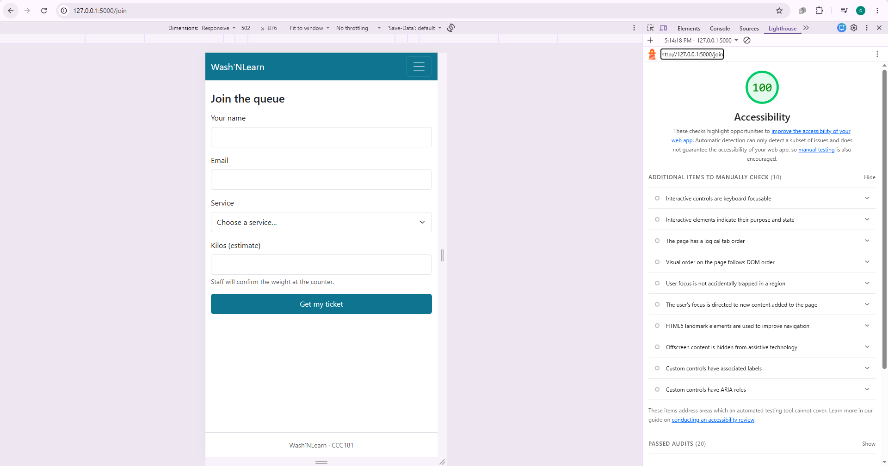
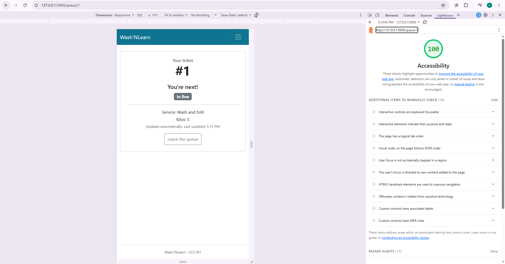
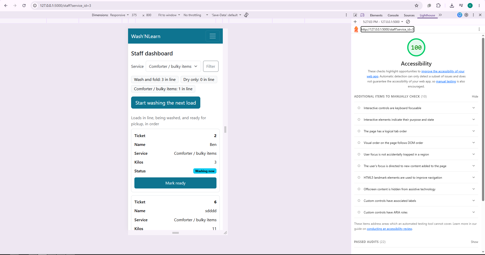

## 9a. Lighthouse (Accessibility, Mobile)

| Screen | Score | Screenshot |
| --- | --- | --- |
| Join | 100 |  |
| My place | 100 |  |
| Staff | 100 |  |

## 9b. Keyboard only

I put the mouse away and used only Tab, Shift+Tab, Enter, Space, and the arrow keys.

**Join from the home page:**
- The "Skip to main content" link appeared on the first Tab, and Enter moved focus to the main content.
- I could see the focus outline at every step.
- I reached "Join the queue", filled in name, email, service (with the arrow keys), and kilos, and submitted with Enter.

**Staff dashboard:**
- I reached the Staff link in the navbar and opened it with Enter.
- I could see the focus outline at every step.
- I chose a service in the filter with the arrow keys, pressed Filter with Enter, and then used Start washing, Mark ready, and Picked up with Enter.

**What failed and how I fixed it:** Nothing failed.

## 9c. Manual checklist

| Check | Join | My place | Staff |
| --- | --- | --- | --- |
| Every input has a visible label | ✅ | n/a (no inputs) | ✅ |
| Error messages say what to do, in text | ✅ | n/a | ✅ |
| Status is shown in words, not only color | n/a | ✅ | ✅ |
| Readable at 375 px, no sideways page scroll | ✅ | ✅ | ✅ |
| Buttons at least about 44 x 44 px on a phone | ✅ | ✅ | ✅ |
| One `<h1>`, headings in order | ✅ | ✅ | ✅ |
| `<html lang="en">` is set | ✅ | ✅ | ✅ |