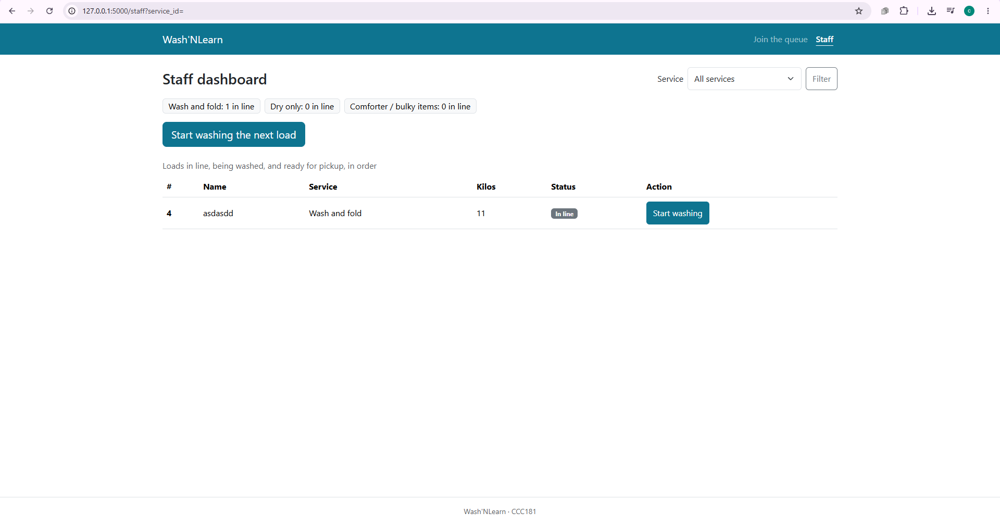
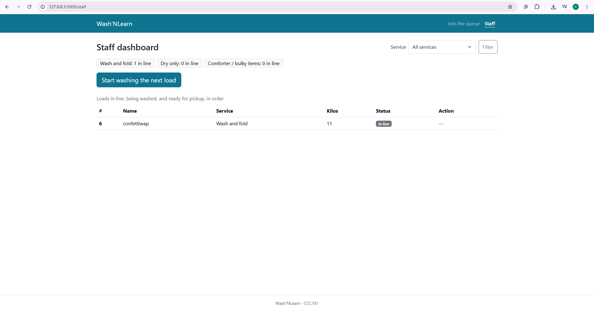

- **Tester:** Dafhnie
- **Persona they match:** Jomar
- **Date and device:** October 25, 2026. PC.
- **How I ran it:** In person
- **Rules I followed:** I read each task aloud, did not help, and asked them to think aloud.

## Task 1: "You just arrived. Get in line for Wash and fold."

- **Finished?** Yes, without help.
- **About how long:** 30 seconds.
- **Where they hesitated, what they said, and surprises:** They asked what the email field is for.
- **Rules that held up:**
  - Held: Jomar's rule that the Join form asks only for name, email, service, and kilos, with no password. They finished in 30 seconds with no help.
  - Partly held: the same rule, because the form is short but does not explain why it asks for an email.
  - Not tested: her slow mobile data, because the test ran on a normal connection.

## Task 2: "How many people are ahead of you? What is your number?"

- **Finished?** Yes, without help.
- **About how long:** 10 seconds.
- **Where they hesitated, what they said, and surprises:** Nothing. She answered both questions without hesitating.
- **Rules that held up:**
  - Held: Jomar's rule that the ticket number and loads ahead must be the biggest thing on My place. They found both in 20 seconds with no hesitation.

## Task 3: "Pretend you work at the laundry. Start washing the next load, then mark it ready and picked up."

- **Finished?** Yes, without help.
- **About how long:** 1 minute.
- **Where they hesitated, what they said, and surprises:** They asked why there are two buttons for starting a wash: "Start washing the next load" at the top and "Start washing" in each row of the table.
- **Rules that held up:**
  - Partly held: Aling Nena's rule that she must know what to do next at a glance. They finished with no help, but it was the longest task, and the duplicate buttons made them stop and ask.
  - Did not hold: Aling Nena's rule that she can mark unclaimed loads as not collected with one clear button. I removed that button during design review, so the dashboard cannot clear loads nobody collects.
  - Not tested: her rule for large, spaced buttons with wet hands. The tester did not mention any trouble pressing buttons and her hand is clean using keyboard and mouse.

## Improvement (10b)

- **Most serious problem:** On the staff dashboard, two buttons did the same thing with almost the same label: "Start washing the next load" at the top and "Start washing" on every waiting row. The tester stopped to ask why. This was the longest task, and it is the action Aling Nena does most often. It breaks the usability principle of consistency: one action should have one clear place and one clear label.
- **My fix:** I removed the "Start washing" button from the waiting rows. The top button is now the only way to start the next load, and waiting rows show a dash. "Mark ready" and "Picked up" stay on their rows, because each of those applies to a specific load. My wireframes showed a "Start washing" button on every card, so this changes my design, and I wrote that in my report.
- **Before:** 
- **After:** 

## Smaller finding

The email question from task 1 was a smaller problem. I added a short hint under the field: "The shop may contact you about your laundry."