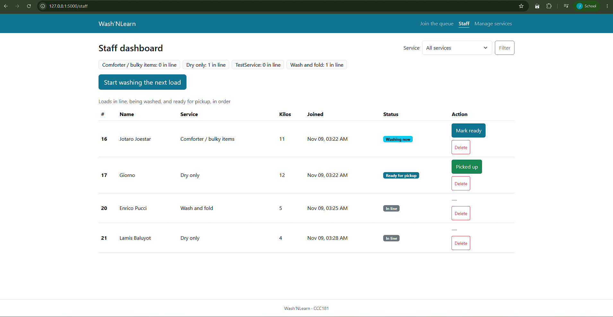
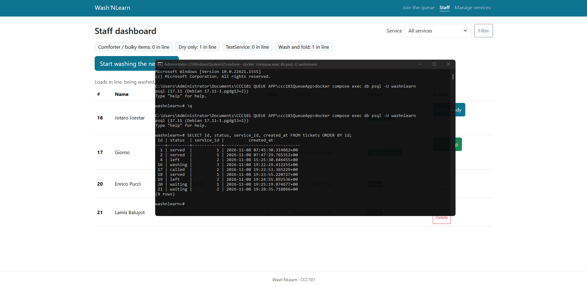
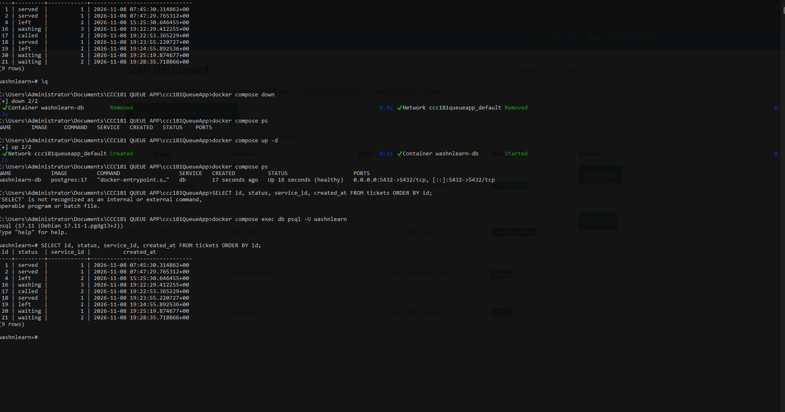

# Persistence proof

## Restart test

1. I created more than five tickets across at least two services. One was called, one was picked up, and one left the queue.
2. Before the restart, I took a screenshot of the staff dashboard and the result of `SELECT id, status, service_id, created_at FROM tickets ORDER BY id;`.
3. I stopped Flask with Ctrl+C and ran `docker compose down`. `docker compose ps` showed nothing running.
4. I ran `docker compose up -d`, waited until `docker compose ps` said healthy, and started Flask again.
5. I took the same two screenshots again. Every ticket, status and time is exactly as before.

**Before the restart**




**After the restart**




## Rebuild from scratch

I deleted the database with `docker compose down -v`, started a new one with `docker compose up -d`, and rebuilt it with:

```
flask --app app db upgrade
flask --app app seed
```

RESULT: The app opened, the join form showed my three services, and I could join the queue.