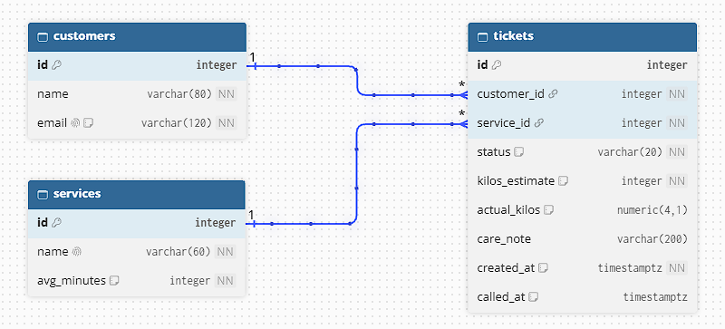
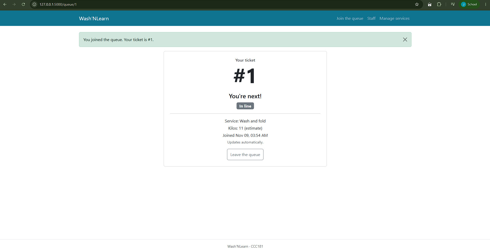
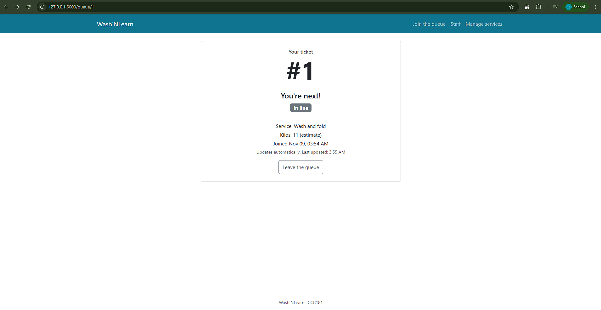
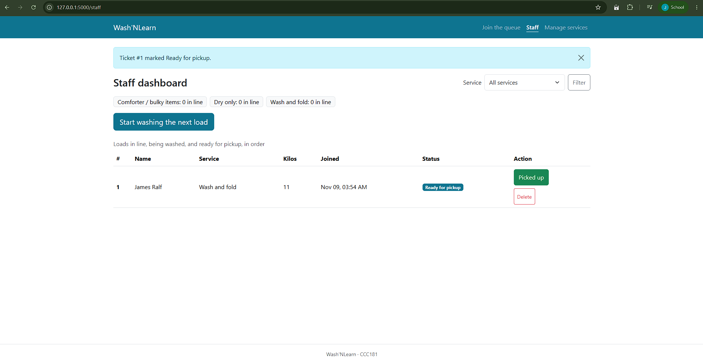
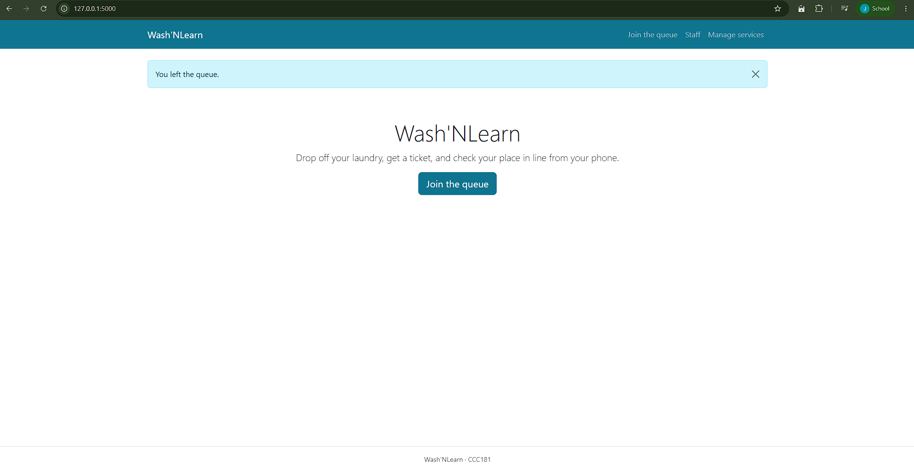
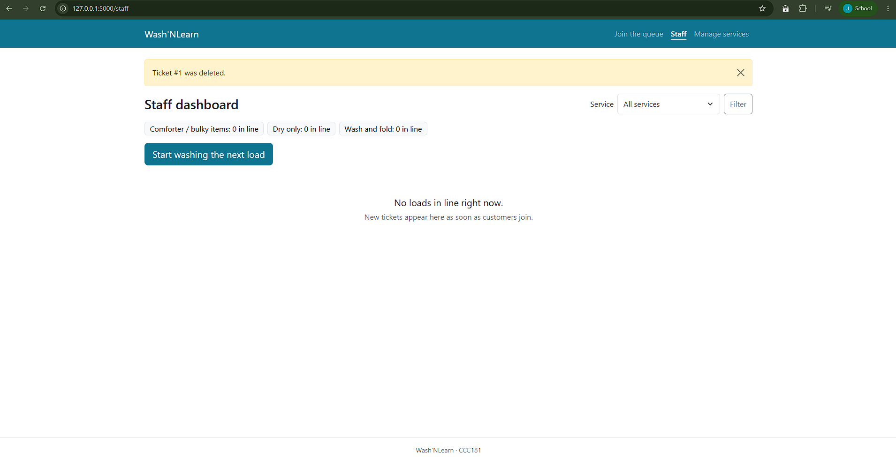
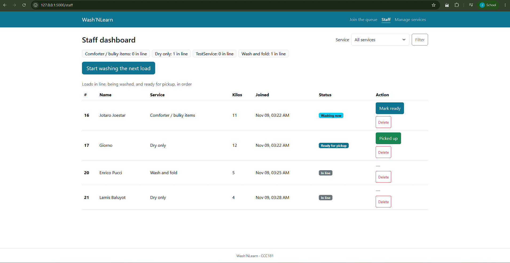
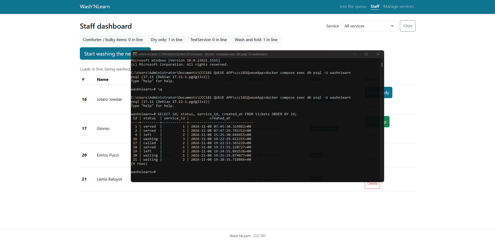
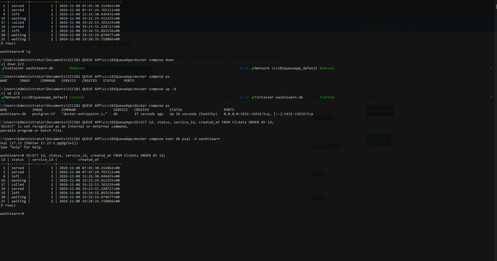

# Wash'NLearn: Week 4 report

## 1. Title details

- **App name:** Wash'NLearn
- **Setting:** A neighborhood laundry shop
- **Name:** James Ralf P. Canonigo
- **Student ID:** 2024-0525
- **Section:** CS3A
- **Date:** November 9, 2026
- **Pull request:** https://github.com/cmformeonly/ccc181QueueApp/pull/4

## 2. Requirements

I wrote 16 functional requirements (5 of them setting-specific ★) and 6 non-functional requirements. The full list is in [requirements.md](../requirements.md).

**MVP:** FR-01, FR-02, FR-03, FR-04, FR-05, FR-06, FR-07, FR-09, FR-15, plus NFR-01 to NFR-05. This is the smallest version that solves the problem: a customer can join, find their ticket again and see when their laundry is ready, and the shop can run the queue and keep its list of services. The data must also survive restarts.

**Checked with a customer:**

- The customer asked how to get back to a ticket after closing the page, so I added FR-15 (Must).
- The customer wanted a rough time for when the laundry will be ready, so I added FR-16 ★ (Could).

## 3. ERD



- One customer has many tickets.
- One service has many tickets.
- Each ticket belongs to exactly one customer and exactly one service.

The full design is in [schema.md](schema.md).

## 4. Schema

**\d customers**
```
                                    Table "public.customers"
 Column |          Type          | Collation | Nullable |                Default
--------+------------------------+-----------+----------+---------------------------------------
 id     | integer                |           | not null | nextval('customers_id_seq'::regclass)
 name   | character varying(80)  |           | not null |
 email  | character varying(120) |           | not null |
Indexes:
    "customers_pkey" PRIMARY KEY, btree (id)
    "customers_email_key" UNIQUE CONSTRAINT, btree (email)
Check constraints:
    "ck_customers_email_lowercase" CHECK (email::text = lower(email::text))
Referenced by:
    TABLE "tickets" CONSTRAINT "tickets_customer_id_fkey" FOREIGN KEY (customer_id) REFERENCES customers(id) ON DELETE RESTRICT
```
**\d services**
```
                                      Table "public.services"
   Column    |         Type          | Collation | Nullable |               Default
-------------+-----------------------+-----------+----------+--------------------------------------
 id          | integer               |           | not null | nextval('services_id_seq'::regclass)
 name        | character varying(60) |           | not null |
 avg_minutes | integer               |           | not null |
 active      | boolean               |           | not null | true
Indexes:
    "services_pkey" PRIMARY KEY, btree (id)
    "services_name_key" UNIQUE CONSTRAINT, btree (name)
Check constraints:
    "ck_services_avg_minutes" CHECK (avg_minutes > 0)
Referenced by:
    TABLE "tickets" CONSTRAINT "tickets_service_id_fkey" FOREIGN KEY (service_id) REFERENCES services(id) ON DELETE RESTRICT
```
**\d tickets**
```
                                         Table "public.tickets"
     Column     |           Type           | Collation | Nullable |               Default
----------------+--------------------------+-----------+----------+-------------------------------------
 id             | integer                  |           | not null | nextval('tickets_id_seq'::regclass)
 customer_id    | integer                  |           | not null |
 service_id     | integer                  |           | not null |
 status         | character varying(20)    |           | not null | 'waiting'::character varying
 kilos_estimate | integer                  |           | not null |
 actual_kilos   | numeric(4,1)             |           |          |
 care_note      | character varying(200)   |           |          |
 created_at     | timestamp with time zone |           | not null | now()
 called_at      | timestamp with time zone |           |          |
Indexes:
    "tickets_pkey" PRIMARY KEY, btree (id)
Check constraints:
    "ck_tickets_actual_kilos" CHECK (actual_kilos > 0::numeric)
    "ck_tickets_called_at_set" CHECK ((status::text <> ALL (ARRAY['called'::character varying, 'served'::character varying]::text[])) OR called_at IS NOT NULL)
    "ck_tickets_kilos_estimate" CHECK (kilos_estimate >= 1 AND kilos_estimate <= 15)
    "ck_tickets_status" CHECK (status::text = ANY (ARRAY['waiting'::character varying, 'washing'::character varying, 'called'::character varying, 'served'::character varying, 'left'::character varying]::text[]))
Foreign-key constraints:
    "tickets_customer_id_fkey" FOREIGN KEY (customer_id) REFERENCES customers(id) ON DELETE RESTRICT
    "tickets_service_id_fkey" FOREIGN KEY (service_id) REFERENCES services(id) ON DELETE RESTRICT
```

## 5. Design decisions

1. **I stored the customer's estimate and the real weight in two columns (`kilos_estimate` and `actual_kilos`).** In Week 3 my self-review found that customers do not know their laundry's weight until the shop weighs it. Keeping both lets staff record the real weight (FR-11) without overwriting what the customer entered.
2. **Customers have their own table, with a UNIQUE email.** Jomar does not want an account, so he only gives a name and email. A returning customer is matched by email and gets a new ticket, not a second customer row, and the same email lets him find his ticket again (FR-15).
3. **Leaving the queue is a soft delete, a mistaken ticket is a hard delete, and both foreign keys are RESTRICT.** A customer who leaves keeps their row with status `left` (FR-07), so the shop can report on it later. Only a ticket made by mistake is really deleted (FR-14). A service with tickets cannot be deleted, so staff switch it off instead (FR-09).

## 6. Self-review

The full review is in [schema-review.md](schema-review.md). The main problems I found:

- **Coverage:** FR-11 (actual weight) had no column, so I added `actual_kilos` and renamed `kilos` to `kilos_estimate`.
- **Bad data:** `Ana@x.com` and `ana@x.com` could become two customers, so I added `CHECK (email = lower(email))`.
- **Facts that disagree:** a ticket could be `called` with no `called_at`, so I added a CHECK that requires `called_at` for `called` and `served`.

## 7. Migrations

- `f48c037fb22f_initial_tables.py`: creates the `customers`, `services` and `tickets` tables with all keys and constraints.
- `e0ee84ad3782_add_services_active.py`: adds `services.active` so staff can switch a service off (FR-09).

## 8. CRUD

| Operation | Route | Requirement | Screenshot |
| --- | --- | --- | --- |
| Create | `POST /join` | FR-01 |  |
| Read | `GET /queue/<id>` | FR-02 |  |
| Update | `POST /staff/tickets/<id>/ready` | FR-05 |  |
| Soft delete | `POST /queue/<id>/leave` | FR-07 |  |
| Hard delete | `POST /staff/tickets/<id>/delete` | FR-14 |  |

Services can also be created, edited, switched off and deleted at `/staff/services` (FR-09).

## 9. Validation

I tested each rule in Flask (with curl, skipping the form) and in the database (with psql, skipping Flask). Bad requests returned 400 and saved nothing, and every bad insert failed with a PostgreSQL error, one for each constraint type. The full table is in [validation.md](validation.md).

**Most useful error:** `ERROR:  new row for relation "tickets" violates check constraint "ck_tickets_called_at_set"`. It shows the database refusing a ready ticket with no ready time, which protects FR-12 even if my Flask code has a bug.

I also checked with `git grep` that no SQL is built with f-strings, and it printed nothing.

## 10. Persistence






After `docker compose down` and `docker compose up -d`, every ticket, status and time was exactly as before. I also deleted the database with `docker compose down -v` and rebuilt it with `flask db upgrade` and `flask seed`. WRITE the result. NFR-01 (no ticket is lost when the server or the database restarts) passed. Details are in [persistence.md](persistence.md).

## 11. Reflection

The hardest part this week was getting the database connection working. My first `flask db migrate` failed with "password authentication failed" because Docker only sets the password when the volume is first created, so I had to reset the volume with `docker compose down -v` and start again. Later, a `migrate` seemed to freeze for a long time because Docker Desktop was not running, so I learned to check `docker compose ps` first. Moving from the Python list to PostgreSQL also broke My place and the staff dashboard until I replaced every `TICKETS` lookup, and I changed `no-show` to `left` so the code matched my schema.

The requirement I found hardest to write in a testable way was FR-16, the estimated time for when laundry will be ready. "Roughly when" is vague, so I could not say what a pass looks like until I tied it to the service's average minutes and the number of loads ahead.

The report my staff persona, Aling Nena, would want is how many loads were left in "Ready for pickup" for more than 3 days, per service, together with how many customers left the queue before their load started. This would help her clear unclaimed laundry from the shelves, which is one of her frustrations. It needs `called_at` and the `left` status.

## 12. Declaration

**AI Use Declaration**

I used Claude (Anthropic) in preparing this work. WRITE what you actually used it for, for example: explaining concepts, brainstroming, and checking my documents and as well as grammar and language polishing.
