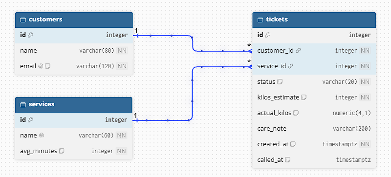

# Wash'NLearn schema design

## 2a. Nouns in my requirements

| Req ID | Requirement | Nouns | Table or column? |
| --- | --- | --- | --- |
| FR-01 | A **customer** can get a **ticket** by entering their **name**, **email**, **service**, and estimated **kilos**. | customer, ticket, name, email, service, kilos | customers, tickets, customers.name, customers.email, services, tickets.kilos_estimate |
| FR-02 | A customer can see their **ticket number**, **status**, and how many loads are **ahead** of them. | ticket number, status, ahead | tickets.id, tickets.status, *(computed)* |
| FR-03 | A **staff member** can see the loads that are in line, being washed, or ready for pickup, in **order**, and filter them by service. | load, order, service | tickets, tickets.created_at, services |
| FR-04 | A staff member can start washing the next load in line for a service. | load, service | tickets.status = washing |
| FR-05 | A staff member can mark a load that is being washed as ready for pickup. | load | tickets.status = called, tickets.called_at |
| FR-06 | A staff member can mark a ready load as picked up. | load | tickets.status = served |
| FR-07 | A customer can leave the queue before their load starts washing. | queue | tickets.status = left *(soft delete)* |
| FR-09 | A staff member can add, rename, and switch off a **service**. | service | services.name |
| FR-11 ★ | A staff member can record the actual **weight** of a load, which may differ from the estimate. | actual weight | tickets.actual_kilos |
| FR-12 ★ | A staff member can see which loads have been ready for pickup for more than 3 days. | ready time | tickets.called_at |
| FR-13 ★ | A customer can add a short **care note** to their load. | care note | tickets.care_note |
| FR-14 | A staff member can remove a ticket that was created by mistake. | ticket | tickets *(hard delete)* |

## 2b. Tables and columns

- `customers`: id, name, email
- `services`: id, name, avg_minutes
- `tickets`: id, customer_id, service_id, status, kilos_estimate, actual_kilos, care_note, created_at, called_at

## 2c. Types and constraints

| Table | Column | PostgreSQL type | Constraint | Why |
| --- | --- | --- | --- | --- |
| customers | id | integer, generated | PRIMARY KEY | Generated by the database, never reused |
| customers | name | varchar(80) | NOT NULL | Staff need a name to hand back the right bag |
| customers | email | varchar(120) | NOT NULL UNIQUE, CHECK (email = lower(email)) | One customer row per email; the CHECK stops "Ana@x.com" and "ana@x.com" from becoming two customers |
| services | id | integer, generated | PRIMARY KEY | Stable identity even if the service is renamed |
| services | name | varchar(60) | NOT NULL UNIQUE | No two services with the same name |
| services | avg_minutes | integer | NOT NULL, CHECK (avg_minutes > 0) | Rejects impossible times; staff always enter it when adding a service |
| tickets | id | integer, generated | PRIMARY KEY | The ticket number customers see; two customers can never get the same one (NFR-02) |
| tickets | customer_id | integer | NOT NULL REFERENCES customers(id) ON DELETE RESTRICT | No ticket without an owner |
| tickets | service_id | integer | NOT NULL REFERENCES services(id) ON DELETE RESTRICT | No ticket for a missing service |
| tickets | status | varchar(20) | NOT NULL DEFAULT 'waiting', CHECK (status IN ('waiting','washing','called','served','left')) | Only the five statuses the app uses |
| tickets | kilos_estimate | integer | NOT NULL, CHECK (kilos_estimate BETWEEN 1 AND 15) | The customer's estimate; matches the 1 to 15 rule on the form |
| tickets | actual_kilos | numeric(4,1) | nullable, CHECK (actual_kilos > 0) | Weighed by staff at the counter (FR-11), so it can be a decimal and is empty until then |
| tickets | care_note | varchar(200) | nullable | Optional (FR-13); most loads have none |
| tickets | created_at | timestamptz | NOT NULL DEFAULT now() | Time zone safe, set by the database, decides the order in line |
| tickets | called_at | timestamptz | nullable; table CHECK (status NOT IN ('called','served') OR called_at IS NOT NULL) | Empty until the load is ready for pickup; the CHECK means a ready or picked-up load always has a ready time (used for FR-12) |

## 2d. ERD

Relationships:

- One customer has many tickets (customers 1 : N tickets).
- One service has many tickets (services 1 : N tickets).
- Each ticket belongs to exactly one customer and exactly one service.
- The foreign keys (`customer_id`, `service_id`) sit on the "many" side, in `tickets`.

Delete rules:

| Foreign key | Rule | Reason |
| --- | --- | --- |
| tickets.customer_id → customers.id | RESTRICT | Old tickets are history, so a customer who has tickets cannot be removed |
| tickets.service_id → services.id | RESTRICT | The shop needs old tickets for reports, so a service with tickets cannot be deleted; staff switch it off instead (FR-09) |

## 2e. Normalization

1. **One value per cell (1NF):** No column holds a list. The care note is one piece of free text, not a list of items.
2. **Depends on the whole key (2NF):** There are no join tables, and every table has a single-column primary key, so no column can depend on only part of a key.
3. **No hidden copies (3NF):** A customer's name and email are stored once in `customers`, and a service's name once in `services`. Tickets only hold keys, so I never have to update the same fact in more than one row.